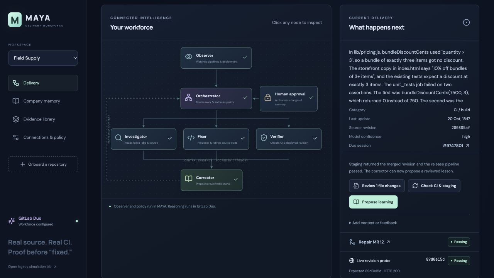
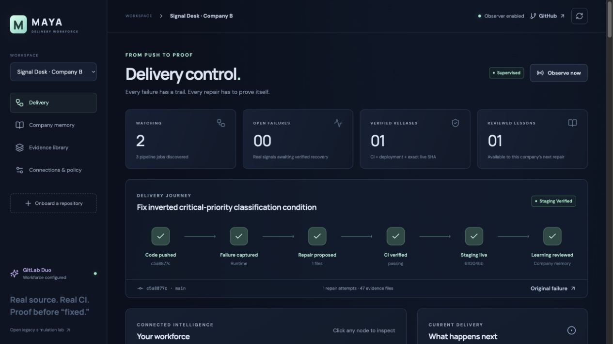

# MAYA has moved to GitLab

The active MAYA source, merge requests, CI, package artifacts, container images
and GitLab Duo workforce now live at:

**https://gitlab.com/gitlab-ai-hackathon/transcend-october-2026/43459489/showcase**

Render deploys MAYA from GitLab. This GitHub repository is archived to preserve
commit history and links from earlier test and delivery receipts.
Please use GitLab for all future MAYA changes.

Signal Desk (`transcend-company-b`) is a separate demo company and stays on
GitHub. It is not a second copy of MAYA.

---

The README below records the previous GitHub-based setup for historical context.

# MAYA · Delivery workforce

**Push code. MAYA investigates failed CI, proposes a source repair through GitLab Duo, opens a repair MR, follows its actual checks and verifies the exact revision deployed to staging. Reviewed company lessons guide later investigations.**

MAYA is the separate automation product. [Field Supply](https://maya-demo-store-af3ce5.gitlab.io), a small ecommerce app with real tests and a GitLab Pages pipeline, is its first end-to-end workload. [Store source and pipeline history](https://gitlab.com/gitlab-ai-hackathon/transcend-october-2026/43459489/maya-demo-store).

The default dashboard shows the delivery journey, clickable workforce diagram, source diffs, failed-job traces, approvals, CI results, deployed revision and company memory. The older deterministic fault-reset experiment remains available at `/?lab=1`; it is historical and is not the CI/CD repair engine.

**Verified demo:** two Duo-authored pricing repairs reached GitLab Pages staging, and a separate Python/FastAPI company recovered through GitHub Actions, a real repair PR and Render staging. The second GitLab investigation retrieved the first reviewed lesson. [Inspect the delivery proof](docs/DELIVERY.md) or follow the [three-minute walkthrough](docs/DEMO.md).





## Run locally

Requires Node.js 24–26. No Docker or paid service is required for the local console.

```sh
npm ci
npm run build
npm start
```

Open http://127.0.0.1:4200. Paste a public GitLab.com or GitHub repository URL to discover source, stack, workflows, environment **names** and deployment policy. A URL does not grant access to private third-party infrastructure. Private source and repair publication need a scoped repository token.

See [a company running on MAYA](docs/ONBOARDING.md) for onboarding boundaries,
the staging workflow and where to inspect each decision in the console.

For real Duo reasoning, configure a project with an enabled instance of [the delivery flow](.gitlab/duo/flows/delivery-workforce.yml):

```sh
export MAYA_DUO_PROJECT_ID=your-project-id
export MAYA_DUO_PROJECT_PATH=your-group/your-project
export MAYA_DUO_CONSUMER_ID=your-enabled-flow-consumer-id
export MAYA_OPS_CONSUMER_ID=your-enabled-delivery-flow-consumer-id
export MAYA_DUO_AUTH=glab
export MAYA_GITHUB_AUTH=gh
npm start
```

Authenticate the official `glab`/`gh` CLIs first. CLI authentication is restricted to localhost. Hosted instances use `MAYA_GITLAB_TOKEN` and optional `MAYA_GITHUB_TOKEN`, or per-company encrypted credentials. Keep credentials server-side; never commit them. See [configuration and architecture](docs/ARCHITECTURE.md).

## What actually happens

1. The observer polls the repository provider and accepts signed webhooks. A failed **current default-branch pipeline** creates a delivery record with preserved raw evidence.
2. MAYA captures failed-job traces and source at an immutable commit. It supplies these and eligible reviewed lessons to the GitLab Duo orchestrator, investigator, fixer, verifier and corrector.
3. Duo returns complete file replacements, original blob identities, a supported diagnosis, requested verification, risks and blocking questions. MAYA validates the artifact and stores the real session and messages.
4. In assisted mode, review the actual diff and approve its digest. MAYA creates a dedicated branch and MR/PR. A stale base or changed source invalidates approval.
5. CI runs on the actual repair commit. Failing repair CI can be reinvestigated from fresh logs and refined on the same branch. Supervised retries are bounded by the repository policy.
6. Merge requires passing exact-commit CI and a current approval. Staging is verified separately: default-branch release CI, successful deployment status and a public version endpoint returning the **exact merged SHA**.
7. The corrector proposes a lesson from the verified outcome. A separate review activates it. Lessons remain scoped by company, project, category, stack and expiry; they do not retrain a model or authorise writes.

## Assisted and supervised staging

Assisted mode separates publication and merge decisions. Supervised staging must be explicitly enabled in the console, with source-sharing consent, write credentials and a discovered policy in the repository:

```yaml
# .maya.yml
version: 1
staging_branch: main
staging_environment: staging
production_requires_approval: true
max_repair_attempts: 3
```

High-confidence source-only repairs can then be proposed, published, checked, refined and merged to the declared staging branch. Tests, CI definitions, scripts and package files still need human review. A changed/removed policy disables automatic staging writes. Production deployment is not implemented or implicitly authorised.

For staging verification, configure a public HTTPS endpoint returning JSON such as `{"commit":"<full deployed Git SHA>"}`. GitLab Pages deployment URLs are discovered where project permissions permit.

## Build, tests and package

```sh
npm run check
npm test
npm run build
npm run test:e2e
npm run format:check
npm audit --omit=dev --audit-level=high
npm pack
```

The package is an unpublished, installable CLI tarball, `maya-agent-sandbox-0.2.0.tgz`. It bundles the backend, UI and flow definition. It is a service with a database, not a library that runs an entire workforce inside an ecommerce frontend.

Backend tests cover source provenance, scope, signatures, secret redaction, stale/concurrent approvals, protected edits, exact revision verification, memory gates, import authorisation invalidation and encrypted checkpoint recovery. UI tests cover onboarding consent, clickable agents, evidence, actual diffs and approval actions, including mobile layout. Fake provider tests validate controller behaviour; they do not count as real Duo or cloud execution. [Delivery proof](docs/DELIVERY.md) records actual sessions, MRs and staging evidence separately.

## Hosting and limits

[Hosted MAYA](https://maya-yard-jassi.onrender.com) uses an operator key. The existing key is `MAYA_ACCESS_TOKEN` in its Render environment. The free Render filesystem is ephemeral. When a cloud Duo project is configured, MAYA stores compressed **AES-256-GCM encrypted checkpoints** on a separate GitLab branch, `maya-state-v2`, and restores them before starting observers. `MAYA_BACKUP_PROJECT_ID` can select a different backup project. The encryption key is `MAYA_ENCRYPTION_KEY` or the stable operator key; losing/changing it without migration prevents restoration. The UI exposes checkpoint status and supports a credential-free export.

This is a **single operator demo**, not an enterprise multiuser system. Checkpoints run about once a minute, are single-writer and can lose changes since the last checkpoint after a hard crash. Use a persistent disk/database for production. API write outcomes that cannot be confirmed are held for reconciliation rather than retried blindly. An uncertain merge is followed with read-only provider checks, so a delayed completion can resume delivery without a second merge write.

During deployment the incoming process claims the current checkpoint with a compare-and-swap before starting observers. A racing final save is reread before handover; the outgoing process cannot overwrite the new owner's checkpoint. Failed ownership confirmation stops startup. Read-only checkpoint inspection does not claim ownership. This accommodates a brief deployment overlap; it is not support for multiple active controllers.

Complete staging journeys are demonstrated for GitLab CI/Pages and GitHub Actions/Render. The current observer handles failures on the current default branch; unmerged feature PRs are not automatically repaired. Universal company onboarding and arbitrary production healing are not established. External services require their own access. Source discovery is bounded; large monorepos and new-file proposals are not supported. Repository commands execute in the company’s CI, never on MAYA’s host.

MIT licensed. Built for [Life After Code](https://gitlab-transcend.devpost.com/).
