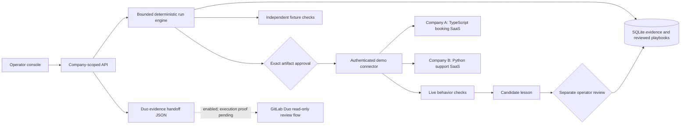

# Architecture and proof boundaries

## State and trust

`Incident → run → captured fixture → minimal proposal → verification → exact approval → demo recovery → post-repair checks → candidate lesson → operator review → active playbook`.

A run is finite and tied to a company/context revision. No worker is an always-running AI watchdog. The V1 UI polls stored progress. There is no claim of live event ingestion from GitHub Actions, Datadog, or other vendors. Connector URLs and tokens come only from server configuration. Only the small supported demo-control APIs are writable.

SQLite records use a company foreign key. Every lookup for incidents, runs, lessons, audit and evidence exports includes that scope. This is logical isolation under one operator; production multiuser authorization, per-tenant credentials, external secret management, retention quotas, and rate limiting remain future work.

Approval is checked against a SHA-256 digest of company, incident, context revision, before/after fixtures, patch, scope, action and live fault instance ID. Both company APIs check that ID and the fault type within the same database transaction as the reset. A replacement fault of the same type therefore refuses the old repair. Authorization and its audit event are committed before the network write. The same run cannot be approved twice. A connected demo fault is conditionally reset, then live behavior must pass.

Injection intent is saved before contacting a company. A lost response retains the incident and requires fresh live evidence. Restart recovery marks unfinished runs and incident summaries interrupted; it never repeats a write. An approved but uncertain recovery can be rechecked through a read-only operation. This may confirm current health, but creates no causal repair lesson. Retrying an investigation refreshes the evidence without injecting another fault. Live mutation and recheck tasks are included in graceful shutdown waiting.

The verifier executes contract assertions against captured baseline and candidate fixtures. Live connectors separately query actual health/availability/classification. Fixture success alone is never shown as live recovery. Because this V1 uses a deterministic scenario recipe, it does not discover arbitrary bugs or edit application source.

## Memory

Active lessons must match company, scenario, runtime and a valid expiry. A candidate comes from a successfully approved and verified run. Both promotion and every reuse revalidate the source artifact, durable authorization, patch identity and verification evidence. The original V1 digest format remains readable for historical playbooks. Rechecked uncertain recoveries are excluded. Retirement preserves records. There is no silent knowledge deletion or model fine-tuning. A revision change invalidates pending approval; a runtime change also refuses lessons for the old runtime.

## Packaging

MAYA's npm tarball contains the built server/client, CLI, docs and Duo YAML. The backend, storage, and a running process are still required. The npm package is not published. Each company can be deployed independently. The parent Docker Compose configuration is a local integration harness and is not a fourth product repository.

## GitLab platform gates

The read-only flow bundle uses `AgentComponent.subagents` defined in the same YAML. It is registered and enabled in GitLab as MAYA Incident Review v1.0.0. The flow service account has Developer access to Showcase, and GitLab reports an available runner. Runtime execution and credits still require a real successful session. Its source is not evidence of execution. The simulator's approvals do not automatically become `HumanInputComponent` approvals in GitLab.

Custom-flow API launch, external MCP configuration, and scoped gateway authentication need a platform proof before any claim of autonomous Duo operation. Normal custom CI/CD variables are not assumed available to Duo flow jobs. No private provider token is embedded in the flow bundle.

## Deployment limits

Local containers run as non-root and use persistent named volumes, loopback-bound public ports, and separate connector tokens. The free Render blueprint uses ephemeral SQLite and may lose state on deployment/restart. It is a demo, not durable production hosting. HTTPS sets Secure cookies for the hosted operator session.
