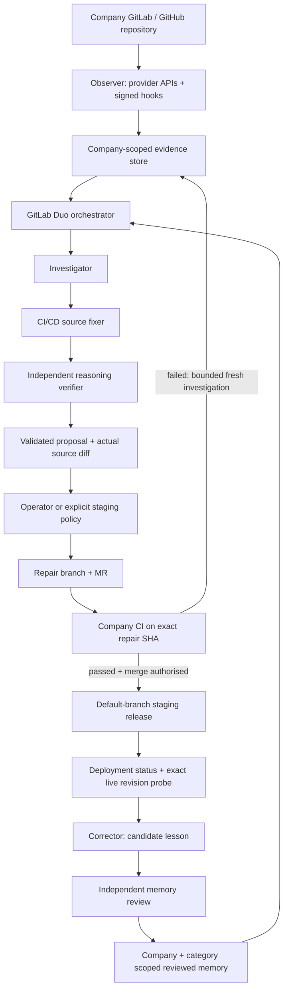

# MAYA delivery architecture

The observer and policy controller run in MAYA. The orchestrator and reasoning specialists run in the enabled GitLab Duo Agent Platform flow. They receive frozen, redacted customer evidence in the goal and have no repository write tools. The controller, using scoped provider credentials, publishes validated source replacements after approval. AI output cannot grant itself access or approval.

## State and evidence

`src/server/operations/storage.ts` adds scoped records, encrypted credentials and durable signal deduplication to SQLite. Evidence carries a content hash, source URL and commit provenance. Original blob IDs bind the model's edits to files it actually saw. Each repair approval is bound to the full plan, repository and base SHA. Publication is reserved locally before the remote mutation; uncertain writes cannot silently repeat after restart.

`workforce.ts` freezes a task's evidence digest and journals launch before calling the actual GitLab workflow endpoint. Completion requires the exact session ID, FINISHED status, an agent report and no checkpoint errors. The structured report is validated against captured sources and task evidence before publication becomes available. Real sessions, messages and errors remain inspectable.

Evidence is bounded before launch to fit GitLab's 65,536-character goal limit.
Investigations prioritise complete relevant source and tests with the tail of
actual failed job logs; reflections retain the changed source, original tests,
validated replacement and compact merge/deployment provenance. Oversized goals
stop locally. Definitive validation/authentication rejections are recorded as
failed launches; timeouts and other uncertain responses remain unconfirmed.
An unconfirmed launch can search GitLab for its exact evidence digest without
creating another session. A uniquely matching session is recovered. If no session
is found, a separate recorded operator decision after at least two minutes can
release the incident for a fresh investigation. An empty search alone is not
presented as proof of rejection, and the original attempt remains in history.

`service.ts` owns delivery state transitions. The same MR can receive a fresh correction after its exact-commit CI fails. Automatic retries are bounded; tests/scripts/CI/package/policy edits require operator review. Stale branches invalidate approval. Supervised publication and merge also reread the staging policy before proceeding. Provider-side branch protection is recommended; MAYA's base read is not an atomic lock against unrelated concurrent default-branch pushes.

A delivery is resolved only after release CI passes, the deployment reports success and the configured HTTPS version endpoint returns the exact merged commit. An old healthy site cannot satisfy that condition. GitLab push pipelines are selected separately from MR pipelines for release verification.

## Onboarding and connections

Discovery supports public GitLab.com/GitHub repository URLs, optional scoped tokens and nested GitLab namespaces. It captures manifests, workflow definitions, a bounded file inventory, languages, recognised tools and environment names. It does not import `.env` values or automatically obtain private vendor access. Repository tokens are encrypted with AES-256-GCM and workspace-bound authenticated data.

Hosted environment variables:

| Variable | Purpose |
| --- | --- |
| `HOST`, `PORT` | HTTP bind; non-loopback requires operator key |
| `DATABASE_PATH` | SQLite path; persistent disk recommended |
| `MAYA_ACCESS_TOKEN` | Operator authentication and default encryption root |
| `MAYA_ENCRYPTION_KEY` | Optional stable credential/checkpoint encryption root |
| `MAYA_GITLAB_TOKEN` | Server-only GitLab API access for enabled flow and accessible company projects |
| `MAYA_DUO_PROJECT_ID`, `MAYA_DUO_PROJECT_PATH` | Duo execution project |
| `MAYA_OPS_CONSUMER_ID` | Enabled delivery-workforce consumer |
| `MAYA_DUO_CONSUMER_ID` | Legacy Duo review flow; also fallback for non-demo delivery setups |
| `MAYA_GITHUB_TOKEN` | Optional server GitHub source/PR access |
| `MAYA_BACKUP_PROJECT_ID` | Encrypted checkpoint destination; Render defaults to Duo project |
| `SECURE_COOKIE=true` | HTTPS cookie protection |

On loopback only, `MAYA_DUO_AUTH=glab` and `MAYA_GITHUB_AUTH=gh` can use authenticated official CLIs. Hosted instances never spawn authenticated user CLIs. The hosted demonstration selects its separately registered delivery consumer; reusable installations should set `MAYA_OPS_CONSUMER_ID` explicitly.

## Data recovery

`backup.ts` compresses and authenticates encrypted operations snapshots, including already-encrypted repository credentials, and commits them to a separate state branch with CI skipped. Restoration authenticates the envelope and evidence hashes before a transaction restores records. A stable encryption key is required. Optimistic file identity rejects conflicting writers. Backups are checkpoints rather than a managed database: a hard crash can lose the most recent interval; ambiguous launches/writes must still be reconciled remotely.

A downloaded JSON workspace export deliberately excludes credentials. Import clears consent, automatic mode, approvals, active task state and lesson activation. Importing a document never grants execution authority.

A periodic save whose acknowledgement is lost rereads the encrypted provider
file. It can reconcile a checkpoint only if its writer identity matches this
process. Only an exact saved snapshot clears the error; an older owned snapshot
does not acknowledge unsaved newer state. Another writer remains fenced. This
reconciliation does not repeat the commit operation.

## Bounds

One operator controls all connected workspaces. Scope isolation prevents accidental cross-company use; it is not enterprise RBAC. Up to 14 prioritised source files are gathered for an investigation, with a bounded evidence budget. Proposals replace existing text files only. Secret paths are excluded and detected credential strings redacted. No company shell command runs on MAYA's host. Public HTTPS probes resolve and pin public addresses, reject private networks/credentials, limit bodies and do not follow redirects.

External signal adapters are supplementary. Complete source-to-staging journeys
are demonstrated for GitLab CI/Pages and GitHub Actions/Render. Automatic failure
selection is limited to the current default staging branch; unmerged feature PR
repair and production rollout are not automated. No universal self-healing claim
is made. The [legacy architecture](LEGACY-ARCHITECTURE.md) describes the separate
deterministic experiment at `/?lab=1`.
