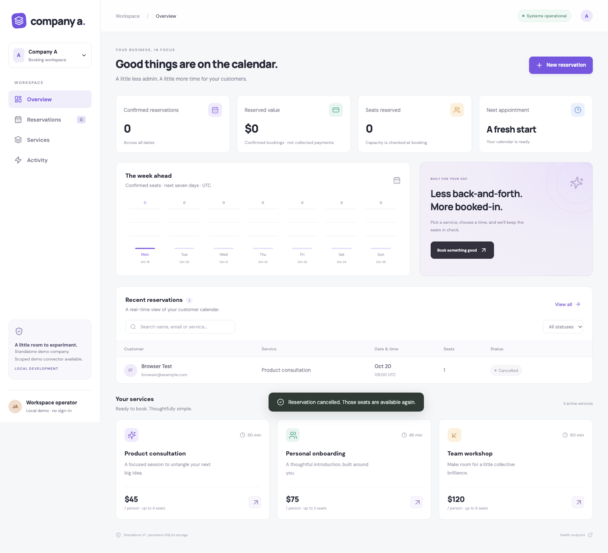
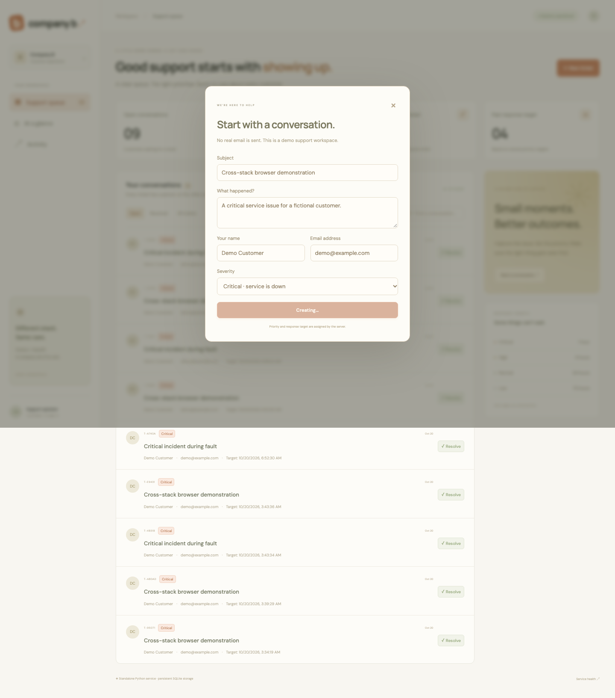
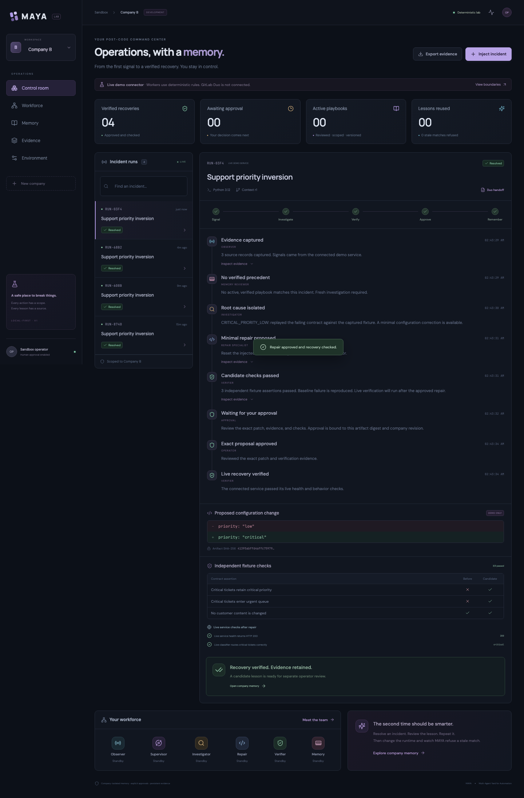

# V1 delivery — 20 October 2026

Three applications are implemented, independently versioned, and integrated locally. The live connector demo recovers two deliberately injected configuration faults on different stacks. **This is a deterministic prototype, not a live AI workforce or a completed GitLab hackathon submission.**

## Recovery hardening retest

The follow-up retest added durable authorization before repair, atomic live fault identity checks in both companies, fresh-investigation and read-only-recheck controls, injection journaling, consistent restart summaries and source validation on every memory reuse. Uncertain recoveries create no repair lesson. Operation errors remain visible across polling. Expected stale-fault refusals return HTTP 409; non-JSON proxy failures display actionable errors without repeating a mutation. A placeholder always-passing assertion was removed; the connected test compares the actual stored ticket content before and after recovery instead.

Mobile navigation and the collapsed new-company button now retain explicit accessible labels; the browser walkthrough exercises all five mobile views and reopening onboarding. Browser coverage now includes three MAYA journeys, Company A's booking journey and two connected journeys. The added proxy-error journey checks that an HTML 502 is readable and never repeats the write. The added connected journey replaces a fault with the same kind while approval is pending: stale approval is refused, a fresh investigation preserves that replacement fault's identity, and newly approved recovery succeeds. The standalone company images are pinned to compatible commit tags in `deploy/compose.yaml`; deliberate overrides use `COMPANY_A_IMAGE` and `COMPANY_B_IMAGE`.

Permanent Render hosting and actual Duo execution remain unverified. On the follow-up, Brave's existing Render session became readable, but navigation continued returning stale page content; the latest attempt is blocked by the Mac lock screen. No cloud deployment is claimed.

## Open the demo

| Application | Local | Temporary public HTTPS preview |
| --- | --- | --- |
| MAYA operator console | http://localhost:4200 | https://debate-caught-johnston-fit.trycloudflare.com |
| Company A — TypeScript booking SaaS | http://localhost:4100 | https://began-sandy-suggesting-beginners.trycloudflare.com |
| Company B — Python support SaaS | http://localhost:4300 | https://bouquet-westminster-upper-modems.trycloudflare.com |

MAYA asks for the operator key. On the original Mac, open the private `.env` in the parent `transcent hackathon` directory and use its `MAYA_ACCESS_TOKEN` value. The key is deliberately absent from source control and this document. Public company data is fictional demo data. Connector keys remain on the server.

The previews are temporary Cloudflare tunnels into the Mac. They work only while the Mac, Docker, network and tunnel processes remain available. They are not permanent cloud deployments. `artifacts/preview-urls.json` in the original parent workspace records these URLs; tunnel logs and PIDs are there too. No system startup service was installed.

## Source and delivery

| Repository | Source | CI runs | Public container image |
| --- | --- | --- | --- |
| MAYA | [transcend-maya](https://github.com/Jassi2004/transcend-maya) | [Actions](https://github.com/Jassi2004/transcend-maya/actions) | `ghcr.io/jassi2004/transcend-maya` |
| A | [transcend-company-a](https://github.com/Jassi2004/transcend-company-a) | [Actions](https://github.com/Jassi2004/transcend-company-a/actions) | `ghcr.io/jassi2004/transcend-company-a` |
| B | [transcend-company-b](https://github.com/Jassi2004/transcend-company-b) | [Actions](https://github.com/Jassi2004/transcend-company-b/actions) | `ghcr.io/jassi2004/transcend-company-b` |

All repositories are public and MIT licensed. Images have `latest` and commit tags. The company hardening pipelines succeeded: [A](https://github.com/Jassi2004/transcend-company-a/actions/runs/39347229929), [B](https://github.com/Jassi2004/transcend-company-b/actions/runs/39347228412). Use the Actions pages for MAYA's final revision result.

The original parent `./start.sh` builds from all three checkouts. From a standalone MAYA clone, `./deploy/start.sh` pulls the public images and starts the same three-service topology. Both use persistent named SQLite volumes, separate server-side keys and loopback ports. They are alternative launchers: running both with their default ports conflicts.

The npm tarball is `maya-agent-sandbox-0.1.0.tgz`, generated by `npm pack`. Its CLI was exercised from the installed package. The package remains private/unpublished; there is no npm registry release claim.

## Verification performed

- **37 backend tests passed after hardening:** 7 booking, 8 Python support, 22 MAYA. Coverage includes capacity transactions, idempotency, routing, validation, exact-artifact approval, company scope, stale memory, rejected actions, interrupted work and operator access. HTTPS proxy login also checks the Secure session cookie flag.
- Company A browser journey created and cancelled a reservation, checked activity, and checked mobile overflow.
- MAYA browser journey completed incident diagnosis, approval, verified recovery, independent lesson promotion, reuse, stale-runtime rejection, and an isolated new workspace; mobile layout was checked.
- The connected browser journey exercised both actual services. During the fault, A's booking request returned **409**; B stored a new critical ticket at the wrong **low** priority. Approved recovery restored availability and reclassified that stored ticket to **critical**. The browser also created a support ticket and created/cancelled a booking after recovery.
- Both connected regression journeys passed over all three public HTTPS URLs after the approval and proxy-error fixes. The stale-approval journey checks the actual HTTP 409 response and verifies that the replacement fault remains unchanged until a newly approved investigation repairs it.
- Both connected companies then promoted a reviewed lesson, reused it on a repeat live incident and verified recovery again. A real MAYA container restart preserved the exact incident, run, lesson and audit counts. Synthetic handoffs from these runs are committed in `docs/examples/` for the first actual Duo review.
- Production Docker builds succeeded. Node backend tests also execute in the Node 24 image build. Containers run as non-root. Local production dependencies audited without reported vulnerabilities at verification time.
- npm compilation, package generation and installed CLI smoke check succeeded. GitLab/Render YAML parsed, which establishes syntax only.

Screenshots from the exercised browser journeys:

| Booking app | Support app |
| --- | --- |
|  |  |

## Five-minute walkthrough

1. Open Company A and make a fictional reservation. Open Company B and create a critical ticket. These are independent working products.
2. Open MAYA, enter the operator key, select Company A, then **Environment → Test live connection**.
3. **Inject incident → Inject & investigate**. Review the failing contract, captured source evidence, exact configuration proposal and independent checks. Company A really has zero availability during this fault.
4. **Approve exact repair**. MAYA calls the authenticated demo-control API and then probes the real service. Approval does not edit application source or merge a pull request.
5. Open Memory, inspect the candidate's source run, then promote it separately. Repeat the incident. MAYA reuses the scoped lesson and skips investigation, while still requiring repair approval and fresh verification.
6. Change runtime metadata in Environment and repeat. The old lesson is refused. This changes MAYA's recorded context, not the container's installed runtime.
7. Select Company B and inject priority inversion. Critical tickets are actually routed low until approved recovery repairs routing and reclassifies open tickets. Its memory is separate from A's.
8. Onboard a new simulation company to inspect isolated state. Only the two preconfigured demo connectors have real service access; arbitrary SaaS integrations are not implemented.

The current local databases retain genuine test history. Counts reflect those records, not fabricated customer or impact metrics.

## Remaining work and access blockers

### Permanent Render hosting

The existing Render account was opened successfully through GitHub login, but no web services were created before the Mac locked. Desktop control then returned “The Mac is locked and automatic unlock could not unlock it.” There was no configured Render API credential to continue without the browser.

When desktop access is available, open [Deploy the blueprint](https://render.com/deploy?repo=https://github.com/Jassi2004/transcend-maya), choose the existing workspace and review `render.yaml`. It defines three free Singapore web services and generated keys. Inspect the assigned service URLs; if Render changes the requested names, update MAYA's `COMPANY_A_URL` and `COMPANY_B_URL` accordingly. Sign in using MAYA's generated `MAYA_ACCESS_TOKEN` in Render Environment. Repeat the connected browser test against the final URLs.

Free Render services sleep and have ephemeral filesystems. Their SQLite records may reset on restart or deployment. The blueprint is suitable for synthetic demonstrations. Persistent cloud storage requires a disk/database decision; the current local Docker volumes are durable.

### Actual GitLab Duo execution — essential for the hackathon

MAYA's workers currently use deterministic recipes. The committed `.gitlab/duo/flows/incident-review.yml` is a read-only supervisor/investigator/verifier source bundle, and each run exports a JSON handoff. **No saved/enabled custom flow or successful Duo runner session has been verified.** Basic Duo access seen earlier is not that proof.

Next steps: mirror the MIT source into the provisioned public GitLab project; register and enable the flow in **AI → Flows**; confirm runner, service identity and credits; run the review against `docs/examples/company-a-duo-handoff.json`; retain its actual result and execution link. Then replace the appropriate deterministic investigation step with the verified Duo interaction. Programmatic launching and secure external gateway access still need platform validation. Do not assume ordinary CI/CD secrets are injected into Duo jobs.

Provisioned project: https://gitlab.com/gitlab-ai-hackathon/transcend-october-2026/43459489/showcase

These gates prevent calling V1 submission-ready. There is also no general GitHub Actions repair, autonomous production monitoring, vendor connector marketplace or arbitrary code-repair implementation. The useful V1 proof is the shared engine, company-scoped reviewed memory and verified recovery across two actual demo stacks.
