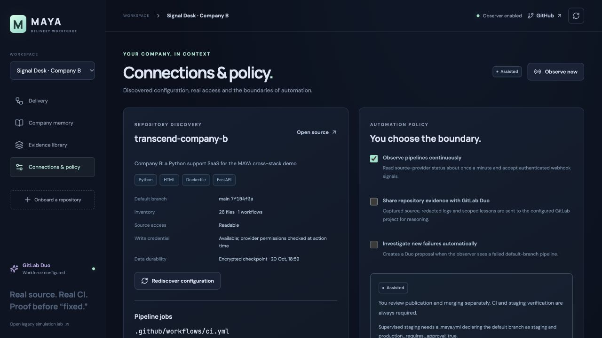

# MAYA V2 delivery proof

MAYA's primary product is now actual CI/CD source repair through GitLab Duo. The first workload is a simple ecommerce app, Field Supply. The earlier bounded fault-reset experiment is retained at `/?lab=1` and documented in [legacy delivery](LEGACY-DELIVERY.md).

- [MAYA console](https://maya-yard-jassi.onrender.com)
- [Ecommerce source + CI history](https://gitlab.com/gitlab-ai-hackathon/transcend-october-2026/43459489/maya-demo-store)
- [Live staging storefront](https://maya-demo-store-af3ce5.gitlab.io)
- [Independent deployed revision](https://maya-demo-store-af3ce5.gitlab.io/version.json)
- [Delivery workforce definition](../.gitlab/duo/flows/delivery-workforce.yml)

## First actual repair

The deliberate source regression changed an inclusive shipping boundary to `subtotalCents > 5000`. The real unit-tests job failed on exactly-$50 shipping and cart pricing. Duo received actual failed-job traces and source snapshots, diagnosed the boundary and returned a complete replacement of `lib/pricing.js`. Its initial unrelated pricing-policy question was clarified as preserving existing pre-discount shipping behaviour before a fresh proposal.

- Failed source commit: `3c7a0903ab0ae63fa527eb7e1c620d04fff3fa07`
- [Initial Duo diagnosis 9744997](https://gitlab.com/gitlab-ai-hackathon/transcend-october-2026/43459489/showcase/-/automate/agent-sessions/9744997)
- [Completed repair workforce 9745458](https://gitlab.com/gitlab-ai-hackathon/transcend-october-2026/43459489/showcase/-/automate/agent-sessions/9745458)
- [Actual repair MR !1](https://gitlab.com/gitlab-ai-hackathon/transcend-october-2026/43459489/maya-demo-store/-/merge_requests/1)
- Repair commit: `2e9c3baa1d1c9a1c481b58451c32f778d4d8459c`
- Staging merge commit: `45a696d7f527acf8b8abe434d96f63cda3e8e53f`

The actual MR changes one comparison from `> 5000` to `>= 5000`. Tests and pipeline files are unchanged. Its unit tests, syntax checks, dependency audit and package job passed before the separately authorised staging merge. The release pipeline 2967383733 passed all six jobs and the live version endpoint returned the exact merged SHA with HTTP 200. Corrector session 9746395 produced lesson version 2, reviewed and activated after checking original logs, tests and merge provenance. The earlier incomplete candidate is retired and retained in history. The first verifier delegation lacked artifacts; its output is not independent validation. Actual CI provides execution evidence, and flow 1.0.1 explicitly forwards complete artifacts to subsequent verifier delegations. See [machine-readable proof](evidence/delivery-v2-first-repair.json).

## Second real repair on hosted MAYA

Hosted MAYA restored the first delivery and reviewed lesson from its encrypted
checkpoint, observed failed pipeline [2967470377](https://gitlab.com/gitlab-ai-hackathon/transcend-october-2026/43459489/maya-demo-store/-/pipelines/2967470377),
and automatically launched [Duo session 9747801](https://gitlab.com/gitlab-ai-hackathon/transcend-october-2026/43459489/showcase/-/automate/agent-sessions/9747801).
The task retrieved reviewed lesson `43ffaeca-486e-4012-a51c-6f81888af945` together with
fresh raw logs and immutable source. The verifier received and traced the actual
proposed replacement. Retrieved memory is evidence of context reuse, not a proven
speed improvement or model retraining.

- Failed source: `280885af0d24d146b7e99ca78e9cfabff772f8c1`
- [Repair MR !2](https://gitlab.com/gitlab-ai-hackathon/transcend-october-2026/43459489/maya-demo-store/-/merge_requests/2)
- Repair SHA: `243008372d6c3ca96703f7abca3cecb0d6dceba0`
- Merge SHA: `89d0e15d178c27427a8c3e81417844086167c144`
- [Release pipeline 2967515978](https://gitlab.com/gitlab-ai-hackathon/transcend-october-2026/43459489/maya-demo-store/-/pipelines/2967515978): all six jobs passed.
- Live version endpoint returned the exact merge SHA with HTTP 200.

Duo changed only `quantity > 3` to `quantity >= 3` in `lib/pricing.js`, restoring the
advertised discount at exactly three items. Existing tests and CI were unchanged.
Publication and staging merge used the explicitly enabled supervised policy.
The original merge request timed out at the HTTP client; GitLab completed that same
request later. MAYA held an uncertain state without another merge write. A proposed
CLI retry stopped at its preflight because the MR was already merged. A read-only
checks refresh reconciled it. The deployed controller adds automatic read-only
reconciliation for delayed merges, with a regression test proving exactly one write.
Both the mistaken operator note about a planned retry and its explicit correction
are retained in the audit/evidence trail.

The corrector's second-outcome session is
[9748345](https://gitlab.com/gitlab-ai-hackathon/transcend-october-2026/43459489/showcase/-/automate/agent-sessions/9748345).
Its candidate was independently reviewed and activated as lesson `6a34526c-ecb3-4b30-81a8-a6ec045841be`. The operator additionally checked the live three-notebook cart: $75 subtotal, $7.50 discount, free shipping and $67.50 total. That browser check supplements the SHA probe; it is not an automated MAYA behavioral probe. See [the second proof](evidence/delivery-v2-second-repair.json).

GitHub Company B was separately discovered as Python/FastAPI with real workflow
configuration. A repository-scoped GitHub token was connected on 20 October;
hosted source discovery and Actions observation then succeeded, and monitoring
was enabled. This removes the earlier unauthenticated API 403 blocker. It is not
a second completed repair/deployment proof or proof that every write permission
has been exercised.

See [the three-minute walkthrough](DEMO.md) for a concise demonstration script.

## Deployed release and restart verification

The first restart verification used application commit `53707348aa23f4f4a010cf4025d3187ada986a8e`.
[GitHub verification, connected-browser tests and image delivery](https://github.com/Jassi2004/transcend-maya/actions/runs/39424975628)
and [the public GitLab pipeline](https://gitlab.com/gitlab-ai-hackathon/transcend-october-2026/43459489/showcase/-/pipelines/2967528551)
passed. The suite includes 40 backend tests and seven UI tests; connected Docker
browser tests validate the historical lab separately from the actual Duo repairs.

After the Render deployment restarted the service, both resolved deliveries, two
active lessons, one retired lesson, six original workforce tasks and both companies'
policies survived. A read-only checkpoint restore into a fresh in-memory database
recomputed all 74 evidence hashes. Authenticated exports also matched those hashes
and excluded credentials. Cross-company evidence reads returned 404; unauthenticated
operations reads returned 401. [Machine-readable final verification](evidence/delivery-v2-final-verification.json).

The demo uses periodic encrypted checkpoints on GitLab, not a production database.
Do not run another controller against the same checkpoint and repositories while
the hosted observer is active. Documentation-only source commits skip CI and Render;
the application revision is recorded separately in each proof file.

An environment-triggered deployment later exposed a checkpoint handover race:
Render briefly overlapped outgoing and incoming processes. The incoming process
now claims the latest encrypted state before becoming healthy; compare-and-swap
prevents an outgoing final save from overwriting it. A racing newer checkpoint
is reread, an ambiguous successful claim is reconciled without another write,
and denied ownership stops startup. Two additional backend tests cover these
conditions; the suite now has 42 backend tests. The earlier verification above
records the previous release separately from this follow-up fix.

The follow-up application `7cd3d97ad739976c5cd339904526aff3723ef86b` is deployed.
[GitHub CI](https://github.com/Jassi2004/transcend-maya/actions/runs/39429472463)
and [GitLab CI](https://gitlab.com/gitlab-ai-hackathon/transcend-october-2026/43459489/showcase/-/pipelines/2967678758)
passed. Hosted Company B source discovery and Actions observation succeeded after
the restart. Its enabled monitoring was written to the encrypted checkpoint and
confirmed through a fresh read-only restore, with all 74 evidence hashes intact.
The two resolved GitLab deliveries, reviewed lessons and six original workforce
tasks remain. [Activation and persistence proof](evidence/github-activation-v2.json).
GitHub PR publication and merge have not yet been exercised; Company B remains
assisted, with Duo sharing and automatic investigation disabled.

## Reproduce

Run MAYA with a configured Duo flow and access to a demo repository. Connect its URL, inspect discovered CI and policy, explicitly allow evidence sharing, then introduce a real source defect on the demo default branch. Observe the failed pipeline. Investigate, inspect actual source diff and evidence, approve publication, wait for exact-commit CI, authorise staging merge and verify the live revision. Propose and review learning separately. For supervised staging, enable its explicit policy consent before introducing a later failure.

The UI and controller tests use fake providers for deterministic validation. They are not evidence of actual Duo execution. Real session, pipeline, MR and deployment records above are independently inspectable. A deliberate source regression is a demo stimulus; its correction is authored by Duo from real logs/source, not a preselected repair recipe.

## Hackathon fit

Official rules were reread in Brave on 20 October. Path A permits a new app, CI/CD and automation; GitLab Duo Agent Platform is required. Its supervised example explicitly includes failing-pipeline repair and staging deployment, followed by production approval. Public MIT GitLab source, visible pipeline history, English project description and a public YouTube demo under three minutes remain submission requirements. Building/deploying MAYA is not a submitted Devpost entry or a guarantee of an award.
